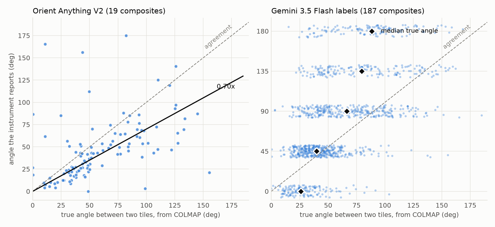
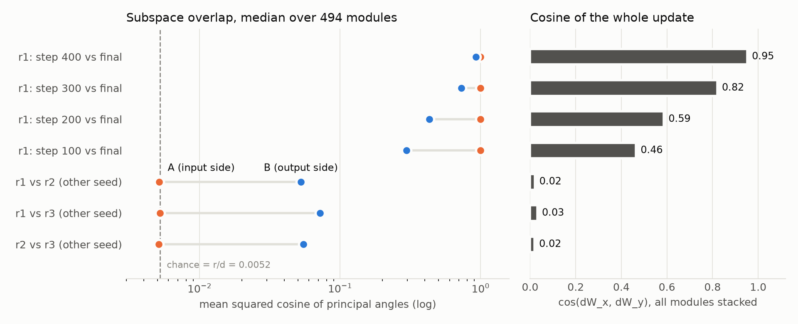

# Four views, one object?

A rank-16 [In-Context LoRA](https://ali-vilab.github.io/In-Context-LoRA-Page/) on
FLUX.1-dev, trained to draw one object from four sides in a 2x2 grid, and an
evaluation built to answer one question honestly:

> **Does the LoRA keep the object consistent across the four tiles without just
> drawing the same view four times?**

The In-Context LoRA paper evaluates by eye. This repo measures: a pre-registered
protocol, paired base-vs-LoRA generation over 42 held-out prompts x 4 seeds x 3
training runs, metrics that were tested against controls before they were
trusted, camera-pose ground truth for the real data, and blinded human ratings.

[Explorer](https://rmsandu.github.io/2D-multiview-generation/) ·
[Protocol](docs/study1_protocol.md) ·
[LoRA notes](docs/lora_notes.md) ·
[Model on Hugging Face](https://huggingface.co/rmsandu/fourviews-incontext-lora) ·
[Demo](https://huggingface.co/spaces/rmsandu/fourviews-incontext-lora)

## Results

*The main generation run is in progress. The verdict, computed by the rule fixed in
[the protocol](docs/study1_protocol.md) before any LoRA image was scored, will be
in [`results/study1/report.md`](results/study1/report.md).*

What is already measured:

**The pose model and the captions disagree with the cameras, in opposite
directions.** MVImgNet ships COLMAP camera poses for part of the data, which gives
the true angle between any two tiles. Orient Anything V2 reads those angles at about
0.70x their size. Gemini's view labels stretch them: tiles it calls "180 deg apart"
are a median 88 deg apart.



**Three runs of the same recipe learn almost orthogonal weight updates (cosine
0.02), and that is LoRA's parametrisation, not disagreement.** The input
projection A stays at its random initialisation; the runs agree on the output side
B at 10-14x chance. Fusing the adapter into 8-bit weights would erase most of it,
so the 8-bit evaluation keeps it unfused.



## How it works

1. **Data.** 529 MVImgNet capture videos; four evenly spaced frames from each form a
   2x2 composite ([pipeline](docs/pipeline.md)).
2. **Captions.** Gemini 3.5 Flash returns a schema-constrained JSON view label per
   tile, or abstains. 423 composites are accepted, 106 abstained.
3. **Split.** 381 train / 42 holdout by source instance, with hash checks against
   leakage (`src/study1_split.py`).
4. **LoRA.** Rank 16, alpha 16, 500 steps with [AI Toolkit](https://github.com/ostris/ai-toolkit)
   (`configs/study1_pilot.yaml`), trained three times.
5. **Paired generation.** Same prompt, seed and scheduler for base and every adapter,
   8-bit base with an unfused bf16 LoRA (`evaluation/generate_pairs.py`).
6. **Metrics.** Masked DINOv2 and DreamSim identity, Orient Anything V2 viewpoints,
   duplicate and letterbox checks (`evaluation/metrics/`).
7. **Humans.** Blinded 2AFC and per-grid ratings ([rater guide](docs/rater_guide.md)).
8. **Verdict.** Cluster bootstrap over prompts, Holm correction, gates fixed in
   advance (`analysis/study1_report.py`).

## Key decisions and why

* **Identity is never reported alone.** Four copies of one view score perfect
  similarity, which is exactly the failure being tested. Every result is a point on
  identity x view diversity.
* **Metrics had to pass controls first.** One tile copied four times, four different
  objects, shuffled tiles, real photos. Pose accuracy failed and was dropped from the
  verdict; the controls table is in the protocol.
* **The analysis was written down before looking.** The protocol commit (`e73ec48`)
  predates every LoRA metric. Later changes are listed as dated deviations.
* **Three training runs, four seeds, 42 prompts.** The unit of analysis is the
  prompt. Run-to-run spread is part of the result, not noise to hide.
* **8-bit, unfused.** 7-11x faster than bf16 with offload on a 24 GB card, checked
  against the earlier bf16 run, and the only way the update survives quantization.
* **Real photos are never published.** MVImgNet's terms don't allow redistribution,
  so real composites appear as scores, and generated grids as images.

## What didn't work

* **Free-form captions.** The first captions ("This photo shows a 45-degree angle of
  the lamp") were inconsistent. They were replaced by a fixed schema with abstention.
* **Judging by eye.** The first read was "base and LoRA look very similar". That
  could not distinguish an effect from seed noise.
* **A cached base image.** The July `base.png` came from a crashed run and was reused.
  It differed from a fresh render in 97% of pixels. Provenance checks caught it.
* **Trusting the pose model's angles.** I first concluded the real photos span narrow
  arcs. Camera poses showed half of that was the pose model shrinking angles
  (protocol, deviation 1).
* **Undefined left and right.** The captioning prompt never said whose left "left"
  is.

## Limitations

* 42 held-out prompts, all from MVImgNet categories seen in training. Nothing here
  says how the LoRA does on unseen object types.
* Orient Anything's calibration rests on 19 posed holdout composites: 114 tile
  pairs, of which only 19 are truly the same view.
* Human ratings come from the author and one or two friends, not a panel.
* One base model (FLUX.1-dev), one rank, one step count.
* Everything runs in 8-bit. The bf16 check covers base and one adapter on two seeds.

## Quickstart

CPU only, from the committed metric tables:

```bash
make dev && make test        # unit tests (no GPU, no model weights)
make eval-env && make report # rebuild results/study1 from results/metrics/*.csv
```

The GPU path (needs FLUX.1-dev access, MVImgNet, and a 24 GB card) is
`scripts/run_study1.sh`, documented in [docs/pipeline.md](docs/pipeline.md).

### Latest dataset build

| Item | Result |
| --- | ---: |
| Model | `gemini-3.5-flash` |
| Eligible four-view instances | 529 |
| Selected source images | 2,116 |
| Accepted image/caption pairs | 423 |
| Abstention composites | 106 |
| Composites with COLMAP poses | 231 |

## Repository map

| Path | What |
| --- | --- |
| `src/` | view selection, Gemini captioning, batch API, split |
| `configs/` | AI Toolkit training configs |
| `evaluation/` | paired generation, controls, metrics, blinded scorecards, human analysis |
| `analysis/` | report, LoRA anatomy, int8 fusion check, camera arcs, Gemini audit, explorer export |
| `results/` | committed metric tables, summaries and figures |
| `docs/` | protocol, pipeline, LoRA notes, rater guide, future work, explorer site |

## Licenses and credits

Code: Apache-2.0. The LoRA weights and generated images inherit the
[FLUX.1-dev non-commercial license](https://huggingface.co/black-forest-labs/FLUX.1-dev/blob/main/LICENSE.md).
MVImgNet data is under [its own terms](https://github.com/GAP-LAB-CUHK-SZ/MVImgNet)
and is not redistributed here.

Built on In-Context LoRA, AI Toolkit, DINOv2, DreamSim, Orient Anything V2 and
MVImgNet. AI coding assistants were used for parts of the tooling and analysis
code. Cite with [CITATION.cff](CITATION.cff).
