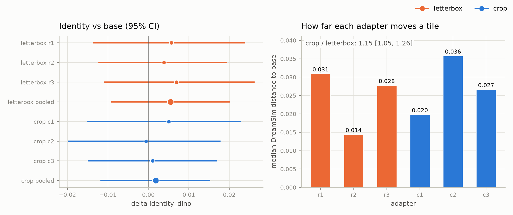

# Study 1b run A results

Object-centred square crops instead of letterboxed tiles, everything else as in Study 1 ([protocol](../../docs/study1b_protocol.md)).

Verdict (pre-registered rule): **no evidence that the LoRA improves identity without a diversity cost**.

Reading (written in advance): **cropping makes the adapter stronger, but not enough to show on identity with 42 prompts**.

| Gate | Rule | Pass |
| --- | --- | :-: |
| A1_identity | pooled CI lower bound > 0 and positive in every replicate | no |
| A2_distinct_views | pooled CI lower bound > -0.25 | yes |
| V_valid_grid | pooled difference > -0.05 | yes |
| H1_humans | pending: no human scores yet | pending |

Crop adapter minus base, 42 prompts x 4 seeds, 95% cluster-bootstrap CI:

| Metric | Base | Pooled crop | Delta (pooled) | c1 | c2 | c3 |
| --- | --: | --: | --: | --: | --: | --: |
| identity_dino | 0.651 | 0.652 | +0.002 [-0.012, +0.015] | +0.005 [-0.015, +0.023] | -0.001 [-0.020, +0.018] | +0.001 [-0.015, +0.017] |
| identity_dreamsim | 0.710 | 0.710 | +0.001 [-0.009, +0.010] | +0.005 [-0.011, +0.018] | -0.002 [-0.017, +0.011] | -0.000 [-0.012, +0.011] |
| identity_dino_unmasked | 0.755 | 0.760 | +0.005 [-0.001, +0.012] | +0.007 [+0.000, +0.015] | +0.003 [-0.007, +0.013] | +0.006 [-0.001, +0.014] |
| distinct_views | 2.208 | 2.256 | +0.048 [-0.075, +0.173] | +0.113 [-0.054, +0.280] | +0.006 [-0.143, +0.149] | +0.024 [-0.119, +0.173] |
| distinct_views_cal | 2.286 | 2.310 | +0.024 [-0.101, +0.147] | +0.095 [-0.065, +0.256] | -0.012 [-0.155, +0.125] | -0.012 [-0.155, +0.131] |
| any_same_view | 0.851 | 0.827 | -0.024 [-0.075, +0.026] | -0.036 [-0.107, +0.036] | -0.024 [-0.083, +0.036] | -0.012 [-0.065, +0.042] |
| valid_grid | 0.839 | 0.841 | +0.002 [-0.028, +0.034] | +0.006 [-0.030, +0.042] | +0.006 [-0.042, +0.054] | -0.006 [-0.048, +0.030] |
| max_letterbox_fraction | 0.000 | 0.000 | +0.000 [+0.000, +0.000] | +0.000 [+0.000, +0.000] | +0.000 [+0.000, +0.000] | +0.000 [+0.000, +0.000] |
| pose_accuracy | 0.185 | 0.187 | +0.003 [-0.022, +0.027] | +0.008 [-0.021, +0.037] | -0.005 [-0.036, +0.027] | +0.005 [-0.026, +0.035] |

Holm-adjusted Wilcoxon p: {"A2": 1.0, "A1": 1.0}

## Crop vs letterbox

Base images identical to Study 1: 168/168 (**yes**).

| Analysis | Estimate, 95% CI |
| --- | --: |
| S1 delta identity_dino, pooled crop - pooled letterbox | -0.004 [-0.013, +0.006] |
| S1 delta identity_dreamsim, pooled crop - pooled letterbox | -0.003 [-0.010, +0.003] |
| S3 delta identity_dino, c3 - r3 (same seed) | -0.006 [-0.021, +0.009] |
| S3 delta identity_dreamsim, c3 - r3 (same seed) | -0.004 [-0.017, +0.007] |
| S2 median distance to base: crop / letterbox | 1.15 [1.05, 1.26] (0.028 / 0.024) |
| S3 median distance to base: c3 / r3 | 0.96 [0.83, 1.08] |



## S4: bars in generated grids

| Arm | max_letterbox_fraction | soft_bar_fraction |
| --- | --: | --: |
| crop base | 0.000 | 0.000 |
| crop c1 | 0.000 | 0.000 |
| crop c2 | 0.000 | 0.000 |
| crop c3 | 0.000 | 0.000 |
| letterbox base | 0.000 | 0.000 |
| letterbox r1 | 0.000 | 0.000 |
| letterbox r2 | 0.000 | 0.000 |
| letterbox r3 | 0.000 | 0.000 |

## Provenance

```json
{
  "records": 672,
  "commits": {
    "8db510d8b14b490d405d89c7e32f7fea34e5f0a6": 26,
    "ac03dc9127e3a6d8ee6a014472f5dbff2f7047e0": 19,
    "8724b7cbaac43a681827058f2741ceaac44b0ade": 627
  },
  "single_commit": false,
  "median_seconds_per_image": 24.788
}
```
