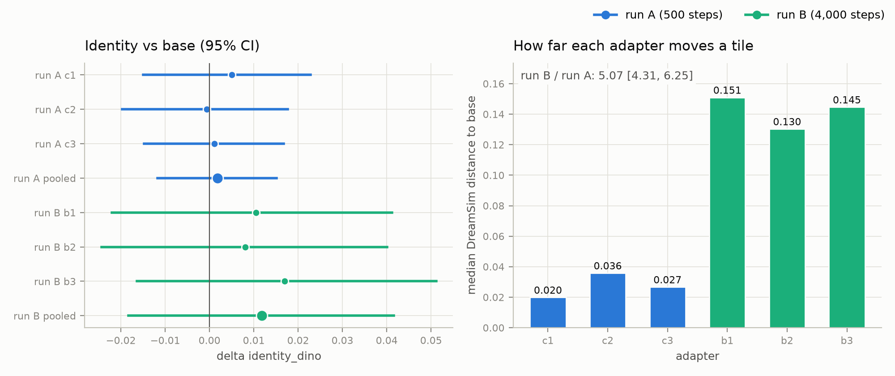

# Study 1b run B results

Run A's 381 crops plus 936 new ones (1,317), trained for 4,000 steps instead of 500, everything else as in run A ([protocol](../../../docs/study1b_protocol.md)).

Verdict (pre-registered rule): **no evidence that the LoRA improves identity without a diversity cost**.

Reading (written in advance): **run B's adapters move images further than run A's, but that still does not show as an identity gain with 42 prompts**.

| Gate | Rule | Pass |
| --- | --- | :-: |
| A1_identity | pooled CI lower bound > 0 and positive in every replicate | no |
| A2_distinct_views | pooled CI lower bound > -0.25 | yes |
| V_valid_grid | pooled difference > -0.05 | yes |
| H1_humans | pending: no human scores yet | pending |

Run B adapter minus base, 42 prompts x 4 seeds, 95% cluster-bootstrap CI:

| Metric | Base | Pooled run B | Delta (pooled) | b1 | b2 | b3 |
| --- | --: | --: | --: | --: | --: | --: |
| identity_dino | 0.651 | 0.663 | +0.012 [-0.018, +0.042] | +0.010 [-0.022, +0.041] | +0.008 [-0.024, +0.040] | +0.017 [-0.016, +0.051] |
| identity_dreamsim | 0.710 | 0.722 | +0.012 [-0.010, +0.034] | +0.010 [-0.014, +0.034] | +0.012 [-0.011, +0.036] | +0.014 [-0.011, +0.040] |
| identity_dino_unmasked | 0.755 | 0.774 | +0.019 [-0.003, +0.041] | +0.017 [-0.009, +0.041] | +0.018 [-0.003, +0.039] | +0.023 [-0.002, +0.048] |
| distinct_views | 2.208 | 2.298 | +0.089 [-0.085, +0.266] | +0.155 [-0.054, +0.369] | +0.054 [-0.149, +0.256] | +0.060 [-0.131, +0.262] |
| distinct_views_cal | 2.286 | 2.359 | +0.073 [-0.103, +0.256] | +0.131 [-0.083, +0.357] | +0.048 [-0.155, +0.250] | +0.042 [-0.161, +0.250] |
| any_same_view | 0.851 | 0.813 | -0.038 [-0.107, +0.030] | -0.054 [-0.143, +0.030] | -0.024 [-0.107, +0.054] | -0.036 [-0.119, +0.048] |
| valid_grid | 0.839 | 0.881 | +0.042 [-0.020, +0.107] | +0.054 [-0.024, +0.131] | +0.036 [-0.030, +0.107] | +0.036 [-0.024, +0.101] |
| max_letterbox_fraction | 0.000 | 0.000 | +0.000 [+0.000, +0.000] | +0.000 [+0.000, +0.000] | +0.000 [+0.000, +0.000] | +0.000 [+0.000, +0.000] |
| pose_accuracy | 0.185 | 0.203 | +0.019 [-0.014, +0.052] | +0.022 [-0.019, +0.063] | +0.019 [-0.017, +0.054] | +0.015 [-0.024, +0.054] |

Holm-adjusted Wilcoxon p: {"A2": 0.479, "A1": 0.479}

## Run B vs run A

* main base images identical to Study 1: 168/168 (**yes**)
* sweep base images identical to Study 1: 24/24 (**yes**)

| Analysis | Estimate, 95% CI |
| --- | --: |
| T1 delta identity_dino, pooled run B - pooled run A | +0.010 [-0.015, +0.035] |
| T1 delta identity_dreamsim, pooled run B - pooled run A | +0.011 [-0.008, +0.031] |
| T2 median distance to base: run B / run A | 5.07 [4.31, 6.25] (0.141 / 0.028) |
| T3 delta identity_dino, step4000 minus step2000 (sweep prompts) | -0.008 [-0.051, +0.039] |
| T3 delta identity_dino, step2000 minus base (sweep prompts) | +0.009 [-0.043, +0.054] |
| T3 delta identity_dino, step4000 minus base (sweep prompts) | +0.001 [-0.050, +0.048] |
| T3 median distance to base: step 4,000 / step 2,000 (sweep prompts) | 1.71 [1.51, 1.97] |

Median distance to base per adapter (T2):

| Adapter | Median |
| --- | --: |
| crop c1 | 0.020 |
| crop c2 | 0.036 |
| crop c3 | 0.027 |
| runb b1 | 0.151 |
| runb b2 | 0.130 |
| runb b3 | 0.145 |
| runb_sweep b1 | 0.143 |
| runb_sweep b1_s2000 | 0.073 |
| runb_sweep b2 | 0.115 |
| runb_sweep b2_s2000 | 0.078 |
| runb_sweep b3 | 0.150 |
| runb_sweep b3_s2000 | 0.082 |



## T4: bars in generated grids

| Arm | max_letterbox_fraction | soft_bar_fraction |
| --- | --: | --: |
| runb b1 | 0.000 | 0.000 |
| runb b2 | 0.000 | 0.000 |
| runb b3 | 0.000 | 0.000 |
| runb base | 0.000 | 0.000 |
| runb_sweep b1 | 0.000 | 0.000 |
| runb_sweep b1_s2000 | 0.000 | 0.000 |
| runb_sweep b2 | 0.000 | 0.000 |
| runb_sweep b2_s2000 | 0.000 | 0.000 |
| runb_sweep b3 | 0.000 | 0.000 |
| runb_sweep b3_s2000 | 0.000 | 0.000 |
| runb_sweep base | 0.000 | 0.000 |

## Provenance

```json
{
  "main": {
    "records": 672,
    "commits": {
      "a6b36ba10823d1344cd8ceaf4ead28b9fec75587": 672
    },
    "single_commit": true,
    "median_seconds_per_image": 24.664
  },
  "sweep": {
    "records": 168,
    "commits": {
      "a6b36ba10823d1344cd8ceaf4ead28b9fec75587": 168
    },
    "single_commit": true,
    "median_seconds_per_image": 24.4165
  }
}
```
